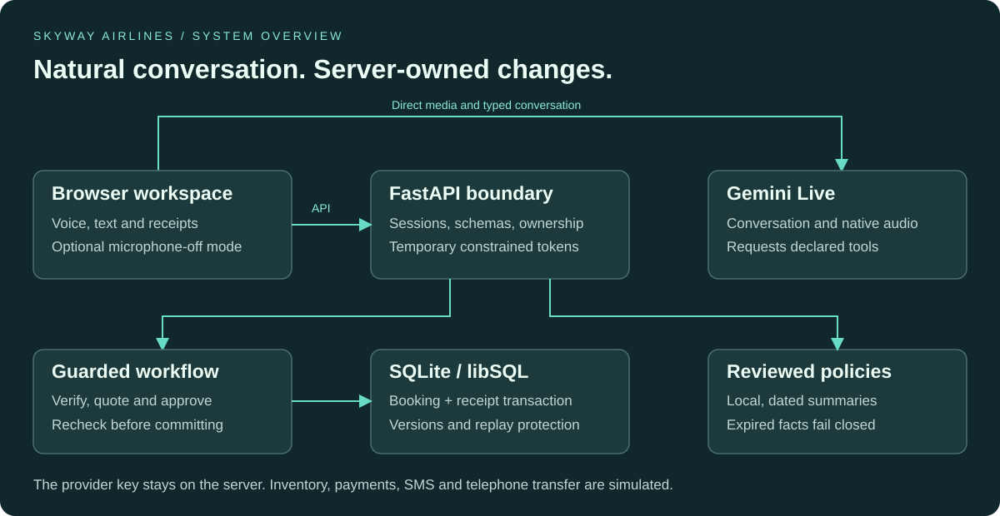
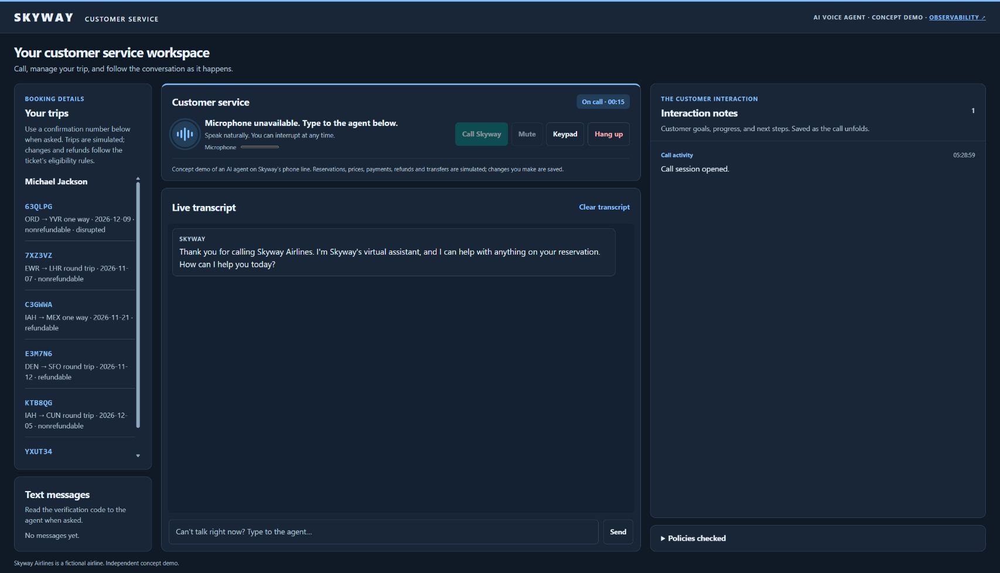
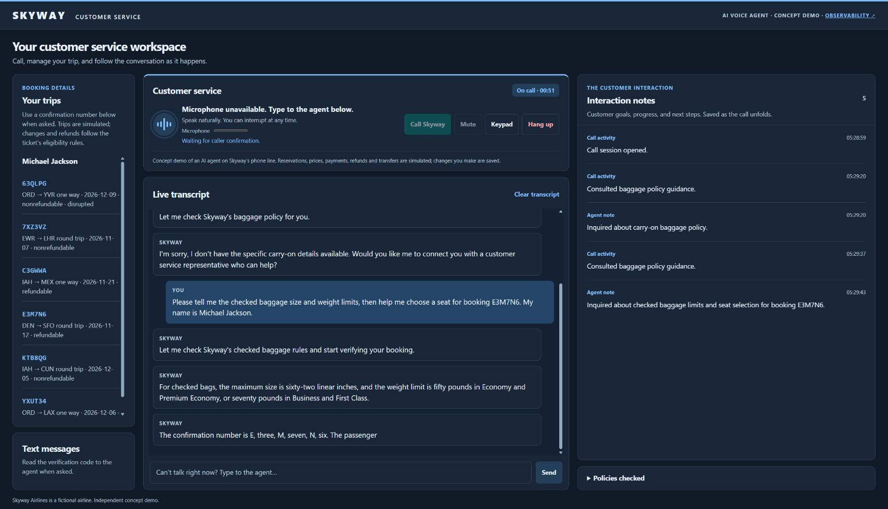
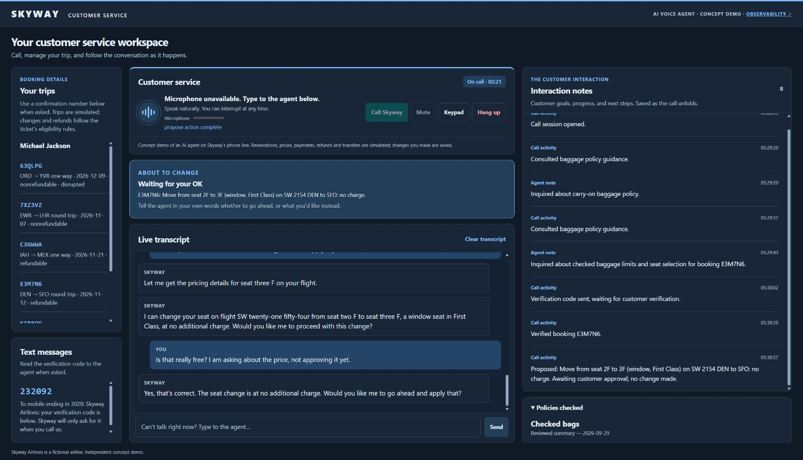
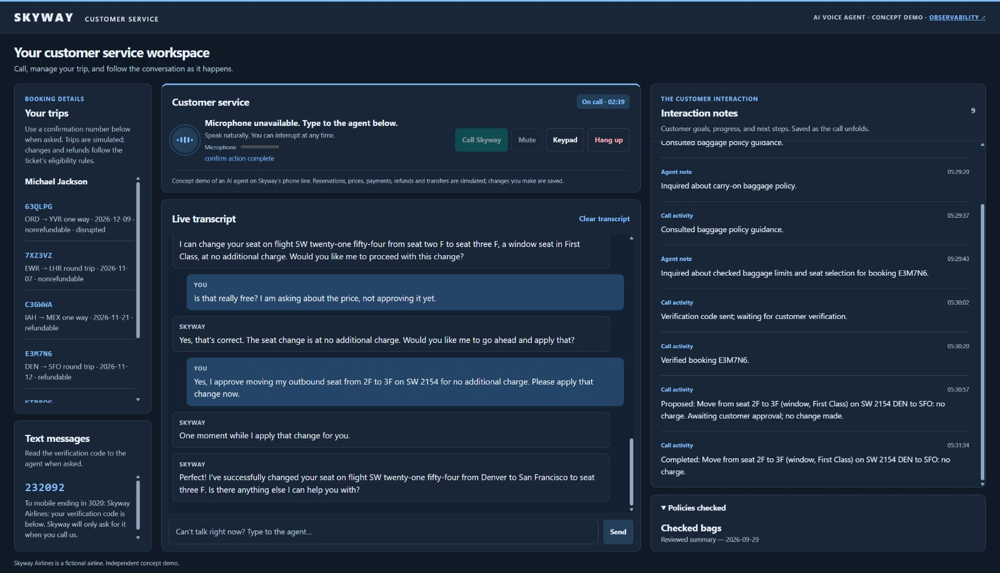
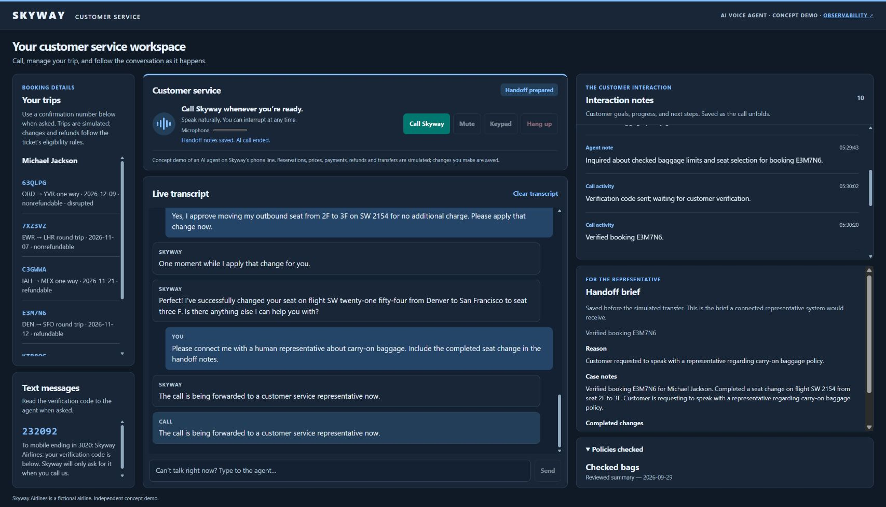
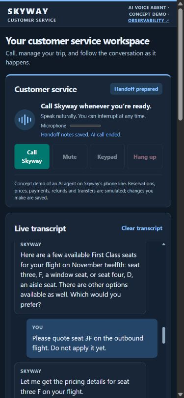

# Airline Voice Customer Assistant

**Native voice conversations. Guarded booking workflows. Observable operations.**

Skyway Airlines is a fictional airline used to demonstrate a customer service experience. Callers can verify a booking, explore changes and approve a quoted action. Gemini handles conversation and audio; Python owns authorisation, prices and database changes.

> **Deployment status:** engineering evaluation with synthetic data. Inventory, identity delivery, payments and telephone transfers are simulated. `APP_ENV=production` intentionally refuses to start until real integrations are implemented and validated. See [release evidence](docs/release-readiness.md).

## Capabilities

| Area | Behaviour |
| --- | --- |
| Conversation | Native audio responses, typed replies, interruptions, bounded reconnects and session resumption. |
| Verification | Name/reference readback, then an expiring, one-use code with a five-attempt limit. |
| Trip servicing | Flight changes, seats, upgrades, meals, bags, assistance, pets and loyalty numbers. |
| Cancellation | Eligibility-based credit or refund-request proposals; no promise of settlement. |
| Approval | A fresh reply bound to a specific quote, two independent judges and a keypad fallback. |
| Recovery | Durable request receipts, replay protection, booking versions and explicit unknown-outcome handling. |
| Policies | Nine local, dated summaries; topics older than 30 days become unavailable. |
| Handoff | A saved case brief and interaction timeline before ending the conversation. |
| Operations | Separate operator access to metrics, traces, logs and call-stage views. |

Schedules, prices, SMS, payments and transfers are synthetic. Changes to demo bookings are real database writes.

## Run locally

Requires **Python 3.11+**, **Node 22.14+**, [uv](https://docs.astral.sh/uv/) and a Gemini key with access to the configured Live model.

~~~sh
npm ci
uv sync --frozen
~~~

Copy `.env.example` to `.env`, set `GEMINI_API_KEY`, then start:

~~~sh
npm start
~~~

Open **http://localhost:3000** in Chrome or Edge. If you change `PORT`, use that port and set `APP_ORIGIN` to the matching origin. Environment files and local databases are excluded from Git.

### Test with the microphone disabled

Open **http://localhost:3000/?microphone=off** before calling. This mode never invokes `getUserMedia`: no microphone permission is requested and no microphone audio is captured. Type caller replies into the conversation box; the assistant still returns voice audio.

Each private browser session receives six sample trips for **Michael Jackson**. Use a displayed confirmation number, confirm the name/reference readback and enter the code shown under **Text messages** as a typed caller turn. The fixture inbox demonstrates a workflow; it is not production identity verification.

A useful evaluation sequence:

1. Ask about baggage policy before identifying a booking.
2. Verify a sample trip and ask for alternative flights or seats.
3. Ask a question about a quote; check that no booking changes.
4. Clearly approve the exact quoted change and review its saved receipt.
5. Request a representative and review the saved handoff brief.

### Screenshots

Captured from the running application in Chrome on **20 October 2026**, using a real Gemini connection and **typed caller input with microphone capture disabled**. Names, trips, messages and verification codes shown are synthetic fixtures. These are application captures, not mock-ups.

**Connected session.** The assistant identifies itself as Skyway Airlines; microphone capture is disabled.

**Reviewed policy.** Checked-bag dimensions and weight limits come from the dated local summary. Missing carry-on rules prompted an offer of human assistance.

**Approval required.** Asking about the price leaves the proposed seat change pending. A database check confirmed seat 2F, version 0 and no saved actions.

**Saved change.** Explicit approval moves the synthetic booking to seat 3F. The database then contained version 1 and exactly one saved action.

**Handoff brief.** The case summary preserves the completed change and unresolved carry-on question before the simulated transfer ends the session. No real telephone transfer occurred.

Mobile layout capture

The workspace was checked with a 390 x 844 viewport override. Its stacked layout had no horizontal document overflow. This is a basic responsive check, not a full device or accessibility certification.

See the [live browser test record](docs/live-browser-test.md) for the exact journey, evidence and limits.

## How changes stay under server control

The browser streams media directly to Gemini using a short-lived, configuration-constrained token. The permanent provider key stays on the backend. Tool requests return through the same-origin API, where schemas, sessions, ownership and workflow state are checked independently of model wording.

~~~mermaid
flowchart TD
    A["Caller request"] --> B["Verify booking ownership"]
    B --> C["Price a proposal"]
    C --> D["Read back quote and price"]
    D --> E{"Fresh approval for this quote?"}
    E -->|"Unclear"| F["Clarify, then offer keypad"]
    F --> E
    E -->|"Declined"| G["Withdraw quote"]
    E -->|"Approved"| H["Recheck version, price and eligibility"]
    H --> I["Commit booking and receipt atomically"]
    I --> J["Report the saved outcome"]
~~~

- Codes expire after five minutes and are one-use. Verification is scoped to the session and booking.
- Proposals expire after ten minutes. Changed prices or booking versions require a fresh proposal and approval.
- Durable request IDs are fingerprinted. Replays return saved results; changed arguments with a reused ID are rejected.
- A timeout does not establish whether a change committed. The browser checks the receipt before retrying with the same ID.
- Cancellation before execution prevents an operation; a committed transaction remains committed.
- Caller text and tool results are data. The model has no shell, arbitrary SQL or arbitrary policy-URL capability.

See the [architecture guide](docs/enterprise.md) and its [offline visual edition](docs/enterprise.html).

## Configuration

| Variable | Purpose |
| --- | --- |
| `GEMINI_API_KEY` | Server-only credential. Never commit it or include it in screenshots. |
| `GEMINI_LIVE_MODEL` | Defaults to `gemini-3.8-live`; availability depends on the provider account. |
| `APP_ENV` | `development` locally, `staging` for protected shared evaluation. Production is blocked. |
| `PORT` | Local launcher port; defaults to 3000. The container listens on 3000. |
| `APP_ORIGIN` | Canonical origin without trailing slash. Staging requires HTTPS and an exact host match. |
| `ACCESS_KEY` | Customer invitation secret; staging requires 32+ cryptographically generated characters. |
| `OPS_ACCESS_KEY` | Separate operator password. Username: `operator`. Missing configuration disables operations access. |
| `TURSO_DATABASE_URL` | SQLite path or hosted libSQL URL. Staging requires an explicit remote or absolute persistent path. |
| `TURSO_AUTH_TOKEN` | Required for a hosted database. |
| `DEMO_DAILY_TOKEN_LIMIT` | Shared rolling 24-hour token issuance cap; defaults to 100. Not a monetary limit. |
| `BOOKING_WRITES_ENABLED` | Only `true` permits new booking commits. The container defaults to `false`. |
| `CONSENT_MODEL`, `CONSENT_VERIFIER_MODEL` | Independent classifiers; staging rejects identical model names. |

Generate customer and operator secrets independently, for example:

~~~sh
python -c "import secrets; print(secrets.token_urlsafe(48))"
~~~

Rotate credentials through the deployment's secret manager. Never put an operator password in a URL.

## Operations and health

Open `/ops` and authenticate as `operator` with `OPS_ACCESS_KEY`. Customer invitation cookies do not authorise operations access. This dedicated password is an evaluation boundary, not enterprise SSO/MFA.

| Route | Purpose |
| --- | --- |
| `/health/live` | Minimal public liveness response; no provider or database calls. |
| `/health/ready` | Database connectivity, provider-key presence and policy freshness; returns 503 when a required check fails. |
| `/api/ops/*` | Operator-only metrics, traces, logs and call views. |
| `/api/telemetry` | Authenticated browser telemetry; a supplied call must belong to the caller. |

Readiness does not prove model access, live identity delivery or production capacity. Telemetry is best-effort: its queue is capped at 64 batches and drops excess work instead of blocking callers. Browser measurements are untrusted diagnostics, not an immutable financial audit trail.

### Observability workspace

The protected dashboard has four connected views:

| View | Use it to investigate |
| --- | --- |
| **Overview** | Request/error rates, API and voice reply percentiles, tool outcomes, approval steps and observed dependency failures. |
| **Traces** | Individual requests and their workflow, database and approval-judge spans in a waterfall. |
| **Calls** | Hashed call journeys, verification, quoted/committed changes, recovery events, model usage and the end reason. |
| **Logs** | Searchable application events linked to their call and trace. |

The browser propagates W3C trace context into API requests; server and browser events are written asynchronously to SQLite/libSQL. Select a window from 15 minutes to 24 hours and drill from a tool/endpoint or call into its traces. Live mode refreshes the active view every ten seconds.

See the [observability guide](docs/observability.md) for access setup, a collection diagram, troubleshooting steps, privacy boundaries, query limits and the meaning of each metric. Recorded telemetry targets approximately 24-hour retention with opportunistic cleanup. It is not a billing ledger or a substitute for production alerting.

## Containerised staging

The Dockerfile uses a separate frontend build stage, hash-locked Python dependencies and a non-root runtime (UID/GID 10001). Environment files, databases and local artifacts are excluded from the build context.

~~~sh
docker build -t airline-voice-assistant:staging .
docker run --rm -p 3000:3000 \
  --env-file .env.staging \
  --read-only --tmpfs /tmp \
  --cap-drop=ALL --security-opt=no-new-privileges \
  --mount type=volume,source=airline-demo-data,target=/data \
  airline-voice-assistant:staging
~~~

Configure staging with HTTPS `APP_ORIGIN`, separate access credentials, provider credentials and either `TURSO_DATABASE_URL=file:/data/demo.sqlite` or a hosted libSQL database. Provision persistent storage writable by UID 10001. Put the backend behind an HTTPS proxy and restrict direct network access.

Set `FORWARDED_ALLOW_IPS` to the specific trusted proxy addresses. Do not trust arbitrary client forwarding headers or use `*` on an internet-accessible backend.

For release artifacts, override `NODE_IMAGE` and `PYTHON_IMAGE` with approved digest-pinned references, scan the image and record its digest. Default image tags are staging conveniences, not immutable production provenance. A real Docker build and image scan remain required.

## Verification

~~~sh
npm test
npm run build
uv lock --check
uv export --frozen --no-dev --no-emit-project --no-header -o requirements.lock
~~~

The [quality workflow](.github/workflows/quality.yml) runs the complete test suite, builds assets, checks hashed requirements and audits npm/Python dependencies. Actions are pinned to commit hashes and repository permissions are read-only. Required branch checks must be configured separately.

Optional provider checks are billable:

~~~sh
npm run smoke
npm run smoke -- --flows
uv run --env-file .env python scripts/eval_consent.py
uv run --env-file .env python scripts/eval_consent.py --cases consent_holdout.json
~~~

Synthetic transcript checks do not replace listening, accent/noise evaluation, accessibility testing, adversarial voice evaluation or representative load testing. Results and limitations are recorded in [release-readiness.md](docs/release-readiness.md).

## Project map

| Files | Responsibility |
| --- | --- |
| `app.py`, `security.py` | API, constrained tokens, HTTP controls and deployment validation. |
| `workflow.py`, `consent.py` | State transitions, approvals and guarded execution. |
| `database.py`, `db_transport.py` | Ownership, verification, transactions and receipts. |
| `tools.py`, `policies.json`, `voice.py`, `instructions.txt` | Inventory, reviewed policies and conversation/tool definitions. |
| `resilience.py`, `telemetry.py`, `ops.py` | Admission, provider isolation and observability. |
| `frontend/` | Voice workspace, audio capture/playback, typed turns and operations UI. |
| `test/`, `scripts/` | Regressions, builds and optional live evaluations. |

## Before real customers

Replace fixture identity and inventory; implement external provider idempotency and outbox/reconciliation; connect a real transfer destination; integrate enterprise identity and operator SSO/MFA; maintain policy/fare feeds; establish privacy, retention and residency requirements; and prove restore, capacity, alerting and rollback procedures.

This repository claims no compliance certification, production capacity or real airline eligibility.

## Technical references

- [Gemini ephemeral tokens](https://ai.google.dev/gemini-api/docs/live-api/ephemeral-tokens)
- [Gemini Live tools](https://ai.google.dev/gemini-api/docs/live-api/tools)
- [FastAPI proxy configuration](https://fastapi.tiangolo.com/advanced/behind-a-proxy/)
- [Starlette middleware](https://www.starlette.io/middleware/)
- [LangGraph](https://docs.langchain.com/oss/python/langgraph/overview)
- [Turso HTTP protocol](https://docs.turso.tech/sdk/http/reference)
