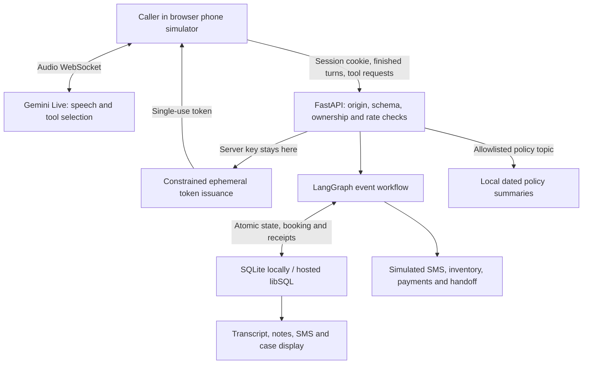
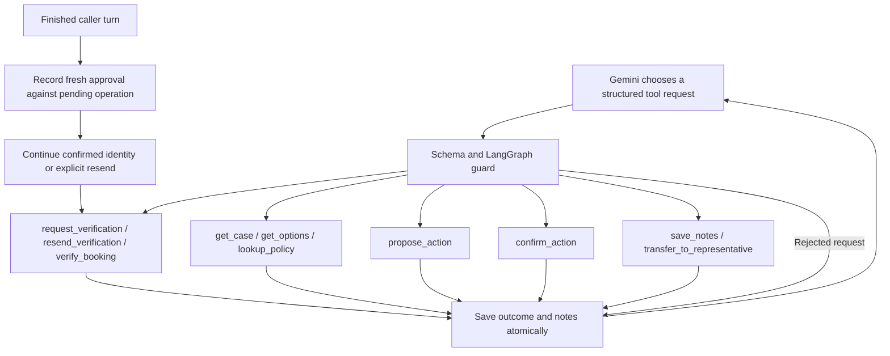
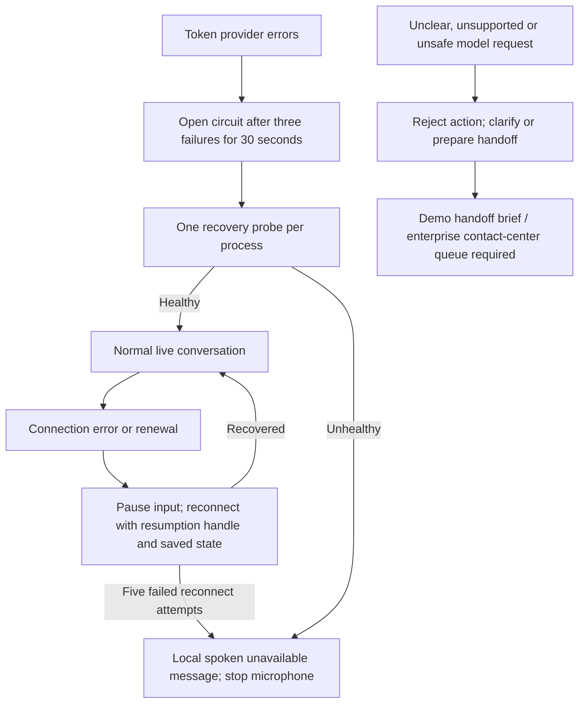
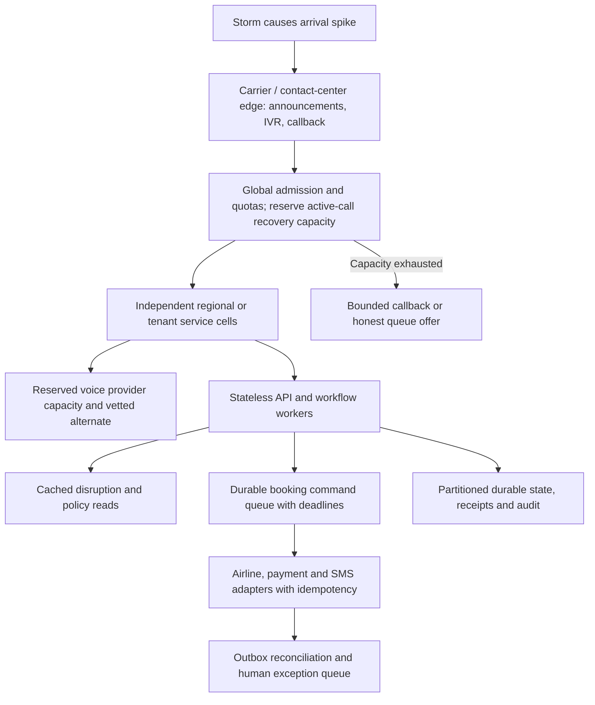

# Skyway voice agent: implementation and enterprise target

Prepared 7 October 2026. This is an independent concept demo, not a Skyway production service. Diagrams distinguish implemented controls from proposed integrations. No claim of million-user capacity is made. One conversational model speaks; a deterministic Python execution layer decides what happens, with small isolated classifier calls judging approvals.

## 1. Current application architecture



The browser captures mono audio with echo cancellation and noise suppression and connects directly to Gemini. FastAPI issues a single-use configuration-constrained token; it never sends the permanent Gemini key to the browser. The browser forwards completed caller turns before their associated tool requests. HTTP results and tool receipts are authoritative; spoken claims are not.

The browser is a demo transport, not a trusted enterprise telephony gateway. A browser client can fabricate transcript events. Real deployment must receive caller audio, turn identifiers and tool events through an authenticated carrier/media service and enforce the same checks server-side. A shared UUID invitation is demo access control, not customer identity.

## 2. Agent architecture and every tool



| Tool | Purpose | Server prerequisite / effect |
| --- | --- | --- |
| lookup_policy | General policy guidance | Allowlisted topic; works before booking verification. Local dated summaries; expired topics require a representative. |
| request_verification | Confirm natural name and reference; optional phonetic clarification, then send code | Six-character reference and full name; the caller's reply to the readback must be judged a confirmation (one classifier call) before the simulated SMS. |
| resend_verification | Replace the verification code | Previously identified booking, awaiting-code state; the caller's turn must be judged a request for a new code or acceptance of an offer; rolling send limit. |
| verify_booking | Verify a caller-supplied code | Fresh unconsumed caller turn, exactly six digits; five-minute expiry, five attempts, one use. |
| get_case | Read current booking and completed actions | Current call's booking must match the session's verified booking and account ownership. |
| get_options | Query flights, seats, upgrades, meals, bags, assistance or pets | Same booking verification; demo inventory and prices. |
| propose_action | Price a change without committing it | Verified booking; server-generated proposal, cancellation eligibility, price and expiry. |
| confirm_action | Apply the pending proposal | Fresh, unconsumed caller turn bound to that quote; two independent judges agree it is an approval and that the quote was heard, or a keypad press at the last ladder step; expiry/version/price/eligibility checks and write switch. |
| save_notes | Append a customer interaction note | Valid session/call, bounded text; six-digit patterns rejected. Notes are model-authored claims, not proof of completion. |
| transfer_to_representative | Save handoff brief and end demo call | Reason and notes required; verified status, completed actions and unapproved proposal included. No real telephone transfer exists. |

LangGraph is an explicit event flow, not another model. Its eight nodes are turn, advance_verification, guard, identity, proposal, commit, read and receipt. It is compiled without a LangGraph checkpointer. Store.call supplies persistence and transactions around each invocation; recursion is capped at 16. Gemini selects requests, Python controls permission and effects.

### Approval of changes

There are no keyword rules. When the agent asks to commit, an isolated classifier with no tools and no conversation history receives the quote, what the agent said and the caller's reply, and returns a typed decision (approve, decline, question, unclear), whether the quote was stated, and the caller's exact words as evidence. The server rejects evidence that is not in the transcript, malformed output and timeouts. A change needs a second, independent judge (a different model with a stricter prompt) to agree; disagreement is unclear. The browser re-sends the transcript, which is accepted only if it matches the hash saved with the caller turn, so no transcript is stored.

Unclear replies climb a server-enforced ladder: a natural re-ask with the quote restated, a closed yes-or-no question, then the keypad (press 1 to confirm, 7 to cancel; spoken approval paused, a spoken refusal still cancels), then a representative. A decline cancels the quote; a question keeps it open. Each caller turn is judged once, so a model retry cannot re-roll the decision or climb the ladder. Receipts store the judges, models and evidence.

Cost: judgments run only when the agent tries to act (commit, resend) or while an identity readback is pending, and the verifier runs only after the first judge approves: about 1.3 short calls per judgment in evaluation, each roughly 500 input and 30 output tokens, small next to the live audio session. Latency: median about 1 s, p95 about 2 to 2.5 s, overlapping the agent's own acknowledgment.

Evaluation (`scripts/eval_consent.py`, 8 October 2026, judge gemini-3.6-flash, verifier gemini-3.5-flash, each case run twice): 63 tuning cases and 34 held-out cases written after tuning, covering natural approvals in several languages, conditions, acknowledgements, sarcasm, dismissive replies, unrelated "yes", unheard quotes and prompt injection. Result: 0 false approvals and 0 false rejections on both sets. One held-out reply ("No, I want cash back, not credit") was treated as declining the credit quote rather than keeping it open; nothing changes either way. This is a small, English-heavy set of synthetic transcripts, not proof of production accuracy: grow it from real, consented call transcripts, add accents, noise and speech-to-text errors, and gate every prompt or model change on zero false approvals. A typed decision model (for example Jev) can replace the first judge behind the same interface if it measures better.

## 3. Agent degradation



Implemented: resumption handles, context compression, connection renewal, bounded retry with jitter, prompt-level noise/hesitation handling, and a local speech-synthesis message when the voice service cannot recover. Token-provider overload and circuit-open responses do not trigger an automatic retry storm. A terminal fallback does not promise that a real representative has answered.

Not implemented: a second speech provider, server-side media relay, independent carrier IVR, or real callback queue. Browser speech synthesis also depends on the user's device. A genuine phone service needs a prerecorded carrier announcement and IVR/human route independent of Gemini and the application region.

Gemini may speak before a tool result arrives. Prompt instructions limit completion claims, but cannot guarantee them. For high-impact operations, route final confirmations through a server-owned speech template after a committed receipt, using a tested TTS path and interruption policy. Native-audio transcript text alone does not prove what was pronounced.

## 4. Tool degradation and uncertain outcomes

```mermaid
flowchart TD
 Request[Tool call with stable request ID] --> Validate[Validate schema, owner, booking and approval]
 Validate --> Receipt{Existing receipt?}
 Receipt -->|Yes| Replay[Return saved result]
 Receipt -->|No| Execute[Bounded operation and transaction]
 Execute --> Success[Commit booking, call state and receipt together]
 Execute --> Lost[Timeout or lost response]
 Lost --> Status[Query tool-status using SAME request ID]
 Status -->|Receipt found| Replay
 Status -->|Unknown transient failure| Retry[At most three attempts, same ID, backoff and jitter]
 Retry --> Status
 Status -->|Still unknown| Escalate[Do not claim success or create replacement action; reconcile or hand off]
Policy lookups use local reviewed summaries, return independent copies, and reject facts older than 30 days. No external airline page is fetched.
 Snapshot -->|Too old / insufficient facts| Escalate
```

The diagram's retry loop is bounded, not infinite. A 22-second response timeout does not prove a synchronous worker or remote commit stopped. Receipts are needed to resolve uncertain outcomes. Provider I/O, remote DB operations and transactions have additional deadlines; provider bulkhead slots remain held while provider calls run.

Demo database atomicity is not an exactly-once guarantee for an external airline or payment system. Before replacing fixtures, implement a transactional outbox, stable provider idempotency keys, delivery/settlement state, retry worker, reconciliation and a dead-letter review queue. SMS acceptance is not delivery; refund submission is not settlement. Do not replay money movement merely because the caller did not hear the result.

## 5. Storm surge: enterprise target, not deployed



No architecture can guarantee that an arbitrary surge will never fail. The objective is controlled degradation: preserve completed changes, avoid duplicate actions, keep recovery accessible, and offer an honest alternative when capacity is exhausted.

Policy lookups use local reviewed summaries, return independent copies, and reject facts older than 30 days. No external airline page is fetched.

Fleet admission, active-call leases, provider quotas, prioritization, regional failover and callback handling must be configured and tested at the carrier/gateway layer. Do not simply raise the demo rate caps and call it scalable. Recovery has a separate API admission lane, but still shares the database, thread pool and per-account rolling budget; reserve these resources at infrastructure level too.

Capacity example (planning assumption, not a benchmark): one million calls/day averages about 11.6 new calls/second. At six minutes per call, the average is roughly 4,167 concurrent calls. A tenfold storm peak implies roughly 41,667 concurrent calls before headroom. Size for measured arrival distribution, call duration, model quota, tool fan-out, DB lock time, carrier ports and retry amplification. One million registered users does not mean one million concurrent calls.

## 6. Technologies: benefits and tradeoffs

| Technology | Benefit | Tradeoff / enterprise action |
| --- | --- | --- |
| Gemini Live native audio | Low-latency speech, interruptions and tool calls in one session | Probabilistic speech and transcription; provider quota/outage dependency. Evaluate accents/noise and hold reserved capacity. |
| Browser Web Audio + direct WebSocket | Simple demo; server avoids audio bandwidth; permanent key stays private | Device variability and client trust boundary. Replace with authenticated telephony/media gateway for phone service. |
| Constrained ephemeral tokens | Limits credential lifetime and session configuration | Stolen live token still has temporary value; token minting adds dependency. Not customer authentication. |
| FastAPI + Pydantic | Typed server boundary and clear validation | Sync I/O uses workers; response deadlines do not cancel all work. Bound provider work and size worker pools. |
| LangGraph | Inspectable routing and mandatory guard paths | Adds orchestration dependency; does not provide auth, idempotency or correctness automatically. Keep rules explicit. |
| SQLite / libSQL | Transactions simplify demo state and receipts | Serialized writes/remote transaction latency can bottleneck surges. Benchmark partitioned storage or a transactional managed DB; preserve invariants during migration. |
| Request IDs + durable receipts | Resolves retries and lost responses for DB effects | External providers need their own keys and reconciliation; receipt retention must cover dispute/retry windows. |
| Exact rolling rate limits | Stops fixed-window boundary bursts | Event storage and cleanup incur DB writes; move high-volume admission to a shared gateway store without weakening atomicity. |
| Circuit breakers + bulkheads | Fail fast and isolate failing dependencies | Process-local state resets on restart; tuning needs measurements. A successful token does not prove the live media service is healthy. |
Policy lookups use local reviewed summaries, return independent copies, and reject facts older than 30 days. No external airline page is fetched.
| Python ASGI host | Runs FastAPI behind an HTTPS reverse proxy; media bypasses the API | Size workers for concurrency and database contention. No telephony runtime is provided. |
| Typed approval judges + ladder | Natural, multilingual approval; fail-closed; audited; cheap because it runs only on commit, with a cascade | Model-dependent and probabilistic: requires a labelled evaluation gate on every change, monitoring of ladder escalations and undo rates; a provider outage falls back to the closed question and keypad. |

## 7. Security and operational readiness

Implemented: schema allowlists, strict request fields, bounded bodies, same-origin JSON, secure production HttpOnly cookies, UUID invitation gate, account/booking ownership, one-use OTP, exact rolling limits, server-bound proposals, durable idempotency, cancellation receipts, version/price checks, escaped UI text and CSP. New BOOKING_WRITES_ENABLED=false pauses new commits while reads and receipt replay remain available; this is an environment setting requiring the process/deployment configuration to reload, not a live remote switch.

Added: process admission, provider isolation and recovery probes, bounded reconnect with spoken failure, whole-reply consent, bounded 200-note timeline, message-ID toast deduplication, request IDs and status/timing logs, /api/health liveness and /api/ready DB readiness. Readiness checks the DB and reports the write switch; it does not certify live-provider health. Production UUID access protection also applies to health endpoints; monitoring needs an authorized access cookie. Logs should be shipped to an access-controlled collector and converted to metrics/alerts; the repository does not provision that collector.

Before real customers: replace simulated identity/SMS/payment/inventory/transfer adapters; authenticate internal services; implement least-privilege service accounts and secret rotation; encrypt and govern retained data; establish consent/retention/deletion policy; test emergency/accessibility routes; get provider privacy/SLA agreements; validate multilingual audio; deploy observability and on-call ownership; prove backup restore and disaster recovery. Notes' six-digit check is not comprehensive PII/payment redaction, and browser transcripts/voice go to the model provider. Do not put real customer data into this demo.

Use proposed SLOs as launch targets, not existing guarantees: zero unauthorized commits in adversarial tests; zero duplicate money effects under injected retry/timeout faults; p95 conversational latency within an agreed audio budget; bounded queue age; measured handoff completion. Alert on token/circuit failures, unknown outcomes, OTP mismatch/resend rates, repeated confirmations, tool p95/p99 latency, admission rejection, DB lock contention and handoff failure. Define numerical targets from pilot measurements before approving release.

## 8. Improvements in priority order

1. Establish a trusted telephony boundary and real identity/inventory/SMS adapters. Preserve the distinction between carrier acceptance, delivery and verification.
2. Add durable outbox/reconciliation and real human queue/callback integration. Require operator review for unknown financial outcomes.
3. Build an audio evaluation set covering accents, noise, pauses, NATO corrections, stale approvals, conditional consent, changed minds, interrupted tools and storm scenarios. Compare completion, unsafe actions and repeated-question rate on every release.
4. Add independent fallback IVR and provider capacity/failover with compatibility tests. Do not switch live providers mid-booking without restored state and receipts.
5. Replace hand-maintained policy snapshots with an airline-owned versioned policy service. Expand missing topics, including carry-on guidance, only from reviewed authoritative content.
6. Load/soak test the actual deployment topology, isolate dependency pools, partition state, and deploy global admission/callback routing. Exercise region loss and provider brownouts.
7. Ship privacy-safe metrics/traces, a governed audit ledger, SLO dashboards and runbooks. Provide an authenticated operations console for reconciliation and emergency write pause.

## References

Async timing: nine tools explicitly declare NON_BLOCKING. Human handoff alone declares BLOCKING: the model waits while the notes and handoff result are saved, and the application announces success before ending the AI call. Its error responses omit asynchronous scheduling and continuation fields. Independent calls launch without awaiting them in the WebSocket message handler. Silent progress uses willContinue=true; final results use WHEN_IDLE and willContinue=false; notes remain SILENT. The agent is instructed to launch work in the same response as one short acknowledgment, allowing backend latency to overlap speech and listening. Tool execution still waits for the caller turn to be saved, and dependent booking mutations still pass server guards.

Backend-initiated verification notices wait for model generation and queued audio to finish before asking for a spoken response. A newer caller turn takes priority. This matters because Live 3.8 client-content turnComplete=true interrupts generation. Prompting and scheduling mitigate repetition; they are not a guarantee of pronunciation or subjective naturalness.

- [Gemini 3.8 Live migration guidance](https://ai.google.dev/gemini-api/docs/models/gemini-3.8-live) confirms asynchronous tools and the interrupting behavior of completed client-content updates. Unsupported thinking-level, affective-dialogue and proactive_audio=false settings are omitted.
- [Live API tools](https://ai.google.dev/gemini-api/docs/live-api/tools) describes tool response scheduling. The installed SDK's FunctionResponse fields are used for scheduling and continuation.

- [Google: ephemeral tokens](https://ai.google.dev/gemini-api/docs/live-api/ephemeral-tokens) describes the constrained client-session credential mechanism.
- [Microsoft: circuit breaker](https://learn.microsoft.com/en-gb/azure/architecture/patterns/circuit-breaker) explains isolating persistent dependency failures and recovery probes.
- [Microsoft: bulkhead](https://learn.microsoft.com/en-gb/azure/architecture/patterns/bulkhead) explains separating resource pools to contain failures.
- [AWS: retry with backoff](https://docs.aws.amazon.com/prescriptive-guidance/latest/cloud-design-patterns/retry-backoff.html) covers bounded retry and idempotency considerations.

Repository anchors: app.py (HTTP/token boundary), voice.py and instructions.txt (tool declarations and conversation policy), workflow.py (graph and guards), database.py and db_transport.py (atomic storage and deadlines), resilience.py (admission/circuit protection), tools.py (inventory/policy), frontend/app.js (audio and recovery).

## 9. Cancellation and refund controls

Cancelling a ticket does not necessarily entitle the caller to cash. The reviewed refund and flexible booking summaries in `policies.json` define the demo rules. The [DOT refund guidance](https://www.transportation.gov/individuals/aviation-consumer-protection/refunds) provides additional context for disruption and purchase-window protections.

The backend allows an unused direct-issued ticket to follow a cash-refund proposal when trusted inventory establishes a refundable fare before departure, a qualifying 24-hour purchase window with at least seven days' advance purchase, or a qualifying airline disruption without accepted alternative travel. The entire demo reservation is cancelled. A credit proposal instead uses stored eligibility, cancellation fee and expiry. A caller's stated reason cannot set any of these fields.

Exceptional-event requests need documentation and human review. Third-party issuance, partial use, existing credits, missing evidence and uncertain departure timing also go to review. This is an automation boundary, not a declaration that the customer has no legal entitlement. Reissued tickets and optional services need real ticket-coupon valuation before production. New fixtures include refundable and nonrefundable fares plus disruption evidence; old records are preserved and require review rather than silently receiving invented eligibility. No automatic cash conversion of previously accepted credit remains.

The same plan runs again at commit. Eligibility or quote changes reject the old approval; a fresh quote and approval are required. Receipts describe a submitted refund request, never settlement. The current implementation supports one passenger and simulated dollar balances. Structured disruption eligibility is trusted inventory evidence, not a model interpretation of a delay description; a real carrier integration must compute it from the official schedule, itinerary, accessibility and acceptance records. Same-day voluntary cancellation goes to review because the demo lacks reliable timezone-aware departure instants.

## 10. Customer experience validation

Local browser testing used typed caller turns through a real Gemini Live audio session with the microphone muted. It exercised identity readback, one code after confirmation, an incorrect code, an explicit resend, successful verification, refund proposal, ambiguous approval rejection, clear approval and handoff with notes. The new connection fallback and deferred verification notice also have frontend regression tests.

Observed limits: one long session renewal was rejected by the provider; the app now terminates safely, but the upstream rejection is not diagnosed. The policy snapshot lacks carry-on detail, so that question correctly escalated. Earlier model wording overstated a refund as processed; receipt instructions now explicitly distinguish submission from settlement. This is a prompt mitigation, not proof that speech always mirrors receipts. Microphone acoustics, accent robustness and spoken pronunciation have not been validated. No production load test or million-caller certification was performed.

Automated checks cover cancellation timing boundaries, nonrefundable rejection, credit fees, missing evidence, accepted alternatives, commit-time changes, verification, replay, transaction rollback, rolling-window rate limits, provider isolation and overload recovery. Production acceptance still requires authentic carrier integration, failure injection, supervised voice evaluations and measurable SLOs.

The final browser cancellation test used a new nonrefundable fixture: identity confirmation produced one code, verification succeeded, the agent offered a priced credit, the caller declined, and the agent explained that an illness exception needs documentation and refund-team review. It offered human handoff instead of approving cash. Old local test data is preserved in its previous database; the running local server uses artifacts/enterprise-local.sqlite with the new mixed-fare fixtures.

Final local verification: 36 Python tests passed, all frontend checks passed, and the production frontend bundle built. These tests validate the implemented controls, not actual airline eligibility decisions or production throughput.
