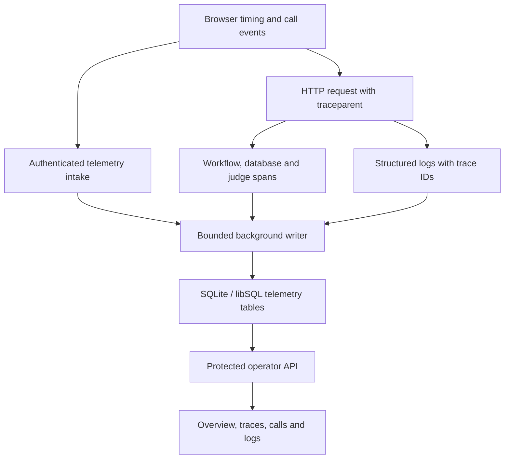

# Observability

The built-in operator workspace connects service health to individual call journeys. It uses OpenTelemetry spans and structured application logs stored in the same SQLite/libSQL database as the application. Metrics are calculated from those spans when the dashboard is queried; no external monitoring service is provisioned.

## Open the dashboard

1. Configure a distinct `OPS_ACCESS_KEY` of at least 32 characters in the server environment. Keep it out of Git, URLs and screenshots.
2. Start the application and visit `/ops` on its configured origin, for example http://localhost:3000/ops.
3. Sign in with HTTP Basic username `operator` and the operator key as the password. Browser authentication is reused for the dashboard's same-origin API and assets. Shared staging requires HTTPS; keep local HTTP on loopback only.
4. Choose **Last 15 min**, **Last hour**, **Last 6 hours** or **Last 24 hours**. Enable **Live** to refresh the active view every ten seconds. Refresh pauses while the document is hidden or a detail drawer is open.

Customer invitation cookies do not grant operator access. Missing operator configuration disables the operational surface. This credential protects global diagnostic views for a single-airline evaluation; it does not implement enterprise identity, SSO/MFA or tenant-specific operator roles.

## What each view shows

| View | Information | Typical investigation |
| --- | --- | --- |
| Overview | Call counts, API request/error/latency metrics, voice reply samples, verification, tool outcomes, approval ladder, dependency events and traffic charts | Establish whether a problem affects the whole service or a particular dependency. |
| Traces | Route/tool/outcome/call search, error filter and a parent-child span waterfall | Follow a slow tool request through workflow nodes, database transactions and approval judges. Select a span for its bounded attributes and correlated logs. |
| Calls | One row per hashed call, verification, workflow stages, changes, reply timing, interruptions, recoveries and model token counts | Open the call drawer to review its event timeline and quote approval steps; use **All traces for this call** to isolate its requests. |
| Logs | Event search and info/warning/error filters, with call and trace links | Correlate an application event with the request that produced it. Logs are operational diagnostics, not a transcript. |

## Collection and correlation

The browser creates W3C trace/span IDs and sends `traceparent` with API requests. The backend extracts the parent context and records HTTP, workflow, database, policy/token and approval-judge spans. Application log records carry the current trace/span IDs. Call identifiers are hashed to 16 hexadecimal characters for correlation; raw booking references are not needed in the dashboard.

Browser telemetry requires an authenticated customer session. If a call ID is supplied, it must belong to that caller and must not be expired. Each intake contains at most 50 spans and is rate-limited to 120 submissions per caller per minute. Attributes are bounded primitives, timestamps are clamped to a recent window and durations are limited to ten minutes. Browser measurements remain untrusted and may be missing or fabricated.

## Read the numbers correctly

| Signal | Meaning and limit |
| --- | --- |
| API p50/p95/p99 | Percentiles of recorded server-span duration in the selected window. Small samples are not a capacity benchmark. |
| Server errors | Recorded error spans or HTTP 5xx responses. An expected workflow refusal or HTTP 4xx is not automatically a server error. Rate limits and busy/503 responses also have separate counts. |
| Voice reply latency | Browser-measured interval from the caller's completed turn to the assistant's first audio. It is not microphone recognition accuracy or a listening-quality score. |
| Active calls | Calls with activity in the last two minutes and no recorded end event. A crashed or disconnected browser can leave the status uncertain. |
| Dependencies | Observed token, policy, consent and database span failures plus recorded circuit events. An idle/closed indicator is not an active probe or proof of provider availability. |
| Approvals | Counts and per-quote steps derived from proposal, caller-turn and commit outcomes. Inspect the durable booking/action receipt for an authoritative financial or reservation outcome. |
| Tokens | Provider-reported usage recorded on agent/judge events. Missing events or absent usage metadata can undercount; this is not billing reconciliation. |
| Recoveries | Recorded nudges, idle check-ins, reconnects and held early refusals. A recovery event alone does not establish that the customer journey succeeded. |

## A practical troubleshooting sequence

1. Select a window containing the incident. A completed test from several hours ago will not appear in the default one-hour window.
2. Review API errors, p95 latency, 429/503 counts and dependency failures on **Overview**. Click a tool or endpoint row to filter its traces.
3. Find the hashed session in **Calls**. Inspect verification, quote steps, judge decisions, committed changes and the end reason in its drawer.
4. Open a timeline event or **All traces for this call**. Use the waterfall to distinguish HTTP time from workflow, database and judge work. Correlate application logs through the same trace ID.
5. For an uncertain booking result, query the saved receipt through the application workflow. Do not reissue a change based only on a missing telemetry event.

For a safe local example, open `/?microphone=off`, start a call, type a policy question and complete a synthetic verification/proposal/handoff journey. The dashboard itself never needs microphone permission. Use only fixture data in published captures.

## Storage, privacy and operating limits

- Telemetry writes use one background thread with at most 64 queued/in-flight batches. A full queue or failed writer drops a batch and emits a content-free warning. An intake response's accepted count confirms validation, not durable delivery.
- Request-local collection caps spans at 500; out-of-request logs use a 500-entry ring buffer. Writer shutdown waits up to five seconds. Process loss can discard pending telemetry.
- Retention targets approximately 24 hours. Cleanup is opportunistic on writes, not a scheduled deletion guarantee; backups and external log copies need their own retention policy.
- Summary/trace/call queries inspect at most 40,000 recent spans. Trace lists return at most 150 rows, call lists 100, log lists 300 and a call detail at most 5,000 call-tagged spans. Busy windows may be incomplete.
- Built-in instrumentation is designed to omit caller transcripts, verification codes, credentials and booking contents. Attribute length/type validation is not comprehensive secret or personal-data detection. Future instrumentation and untrusted browser attributes require review before real data.
- The dashboard is a diagnostic application, not a durable compliance ledger, enterprise alerting platform or SLO certification. It provisions no collector, paging rules, alert delivery, incident ownership or long-term metrics backend.

Before shared production operation, connect an access-controlled collector/backend, define retention and redaction controls, establish measured SLOs and provider spending alerts, test alert delivery and assign on-call ownership. See [release readiness](release-readiness.md) for the remaining deployment gates.

## Implementation map

| Location | Responsibility |
| --- | --- |
| `telemetry.py` | OpenTelemetry span processing, log correlation, bounded writer and storage schema. |
| `app.py`, `workflow.py`, `database.py`, `consent.py` | HTTP and internal workflow/dependency instrumentation. |
| `ops.py` | Summary, trace, call and log queries; authenticated browser telemetry intake. |
| `security.py` | Separate operator authentication and HTTP protections across operational routes/assets. |
| `frontend/ops.html`, `frontend/ops.js`, `frontend/ops.css` | Dashboard charts, searchable tables, timeline and waterfall drawers. |
| `test/test_telemetry.py`, `test/test_telemetry_safety.py`, `test/test_security.py` | Correlation, sensitive-content exclusions, ownership, bounded queue and operator-access regressions. |
